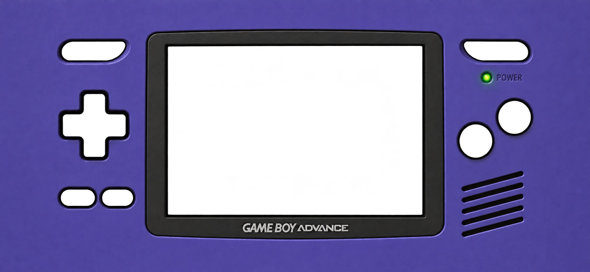

# AdvanceiOS

Kit graphique GBA Indigo pour une interface d’émulation iOS/iPadOS en paysage : **3 façades avec ouvertures transparentes et 7 boutons indépendants**.

Ce dépôt contient les images, leurs repères d’assemblage et un aperçu interactif. Il ne contient pas encore d’application iOS ni de moteur d’émulation.



## Contenu

| Dossier / fichier | Contenu |
| --- | --- |
| [Façades](assets/gba-indigo/facades) | iPhone récent, iPhone classique 16:9, iPad 4:3 |
| [Boutons](assets/gba-indigo/buttons) | Croix, A, B, L, R, Select et Start sur fond transparent |
| [Manifest](assets/gba-indigo/manifest.json) | Dimensions des sources, logements, fenêtre de jeu et limites visibles des sprites |
| [Aperçu](preview/index.html) | Assemblage interactif, simulation des marges et animation d’appui |
| [Intégration](docs/INTEGRATION.md) | Calques, coordonnées, marges iOS, commandes et animation |
| [Formats iOS](docs/FORMATS-IOS.md) | Résolutions paysage de référence et choix de composition |
| [Vérifications et capture](docs/VALIDATION.md) | Contrôles effectués et aperçu assemblé |

## Voir l’assemblage

Après téléchargement ou clonage, ouvrir **preview/index.html** dans un navigateur. Aucun paquet ni compilation n’est nécessaire. GitHub affiche le code HTML ; télécharger le dépôt pour lancer l’aperçu localement.

Autre possibilité, depuis la racine du dépôt :

```sh
python -m http.server 8765 --bind 127.0.0.1
```

Puis ouvrir `http://127.0.0.1:8765/preview/`.

- Cliquer ou toucher les boutons pour voir l’appui.
- Utiliser le sélecteur pour comparer les formats.
- Activer « Voir les ouvertures » pour afficher les zones transparentes.
- Activer « Marges simulées » pour inspecter les zones réservées. Ce sont des valeurs de démonstration, pas des garanties par modèle.
- Clavier : flèches, X=A, Z=B, Q=L, E=R, Entrée=Start, Maj=Select.

## Décisions de conception

La coque violette s’étend aux bords. La disposition est recomposée pour chaque famille : commandes latérales sur iPhone, commandes principales plus basses sur iPad. Le jeu conserve son ratio **3:2**. La version iPhone large réserve une bande décorative aux deux extrémités pour les capteurs ; l’intégration doit aussi utiliser les marges réellement renvoyées par iOS.

Les sept boutons sont livrés dans leur état de repos uniquement. L’enfoncement de l’aperçu utilise une transformation légère ; aucun sprite directionnel ou état enfoncé supplémentaire n’est inclus.

La teinte est une interprétation visuelle commune du violet/indigo de la GBA, référencée sur les [archives matérielles Nintendo](https://www.nintendo.co.jp/n08/hardware/gba/index.html). Les éclairages et textures induisent de petites variations ; aucun code couleur numérique n’est présenté comme une spécification officielle Nintendo.

Les images ont été créées avec l’outil intégré de génération d’images. Les [prompts conservés](docs/prompts-generation.json) décrivent les références, contraintes et étapes. Le pack est une création destinée au projet ; les marques et noms Nintendo/Game Boy Advance restent ceux de leurs titulaires.

## Vérifier le pack

```sh
python tools/validate_assets.py
```

Le contrôle vérifie les dimensions PNG, les sept commandes par façade, les rectangles dans leurs sources, les fenêtres de jeu au ratio 3:2 et la présence de tous les fichiers. L’aperçu reste à tester sur appareil iOS réel avant de figer l’ergonomie.
