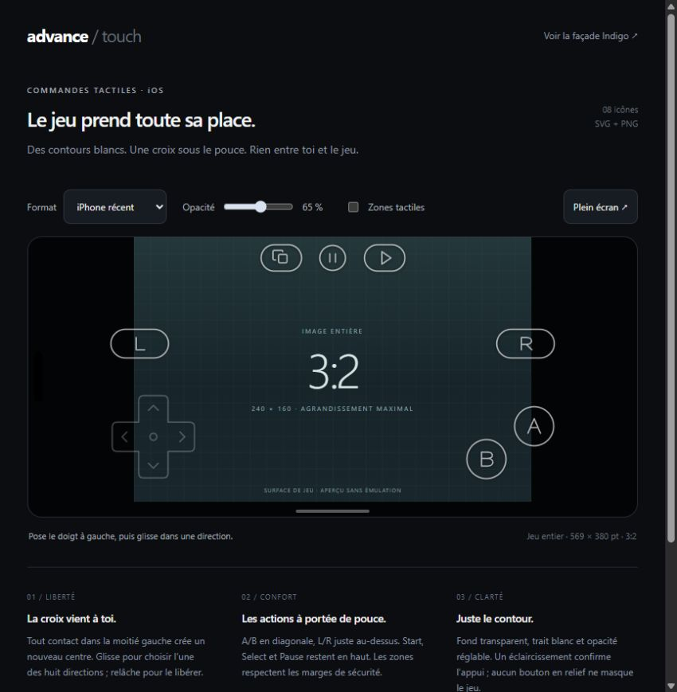

# AdvanceiOS

Émulateur iOS/iPadOS natif basé sur mGBA 0.10.5. **Le jeu occupe la plus grande surface possible, avec des commandes blanches en contour par-dessus et une croix flottante sous le pouce.** Le ratio GBA 3:2 reste intact.



## Ouvrir l’application

Conserver tout le dépôt, puis ouvrir [emulator/ios/mGBA-iOS.xcodeproj](emulator/ios/mGBA-iOS.xcodeproj) sur un Mac avec Xcode 16 ou plus récent. Choisir le schéma **mGBA iOS**. Sur appareil physique, sélectionner son équipe Apple et son identifiant d’application dans Signing & Capabilities.

Le lanceur apparaît dans la surface du jeu : **croix pour choisir, A/Start pour lancer, Select pour importer**. La pause et les options sont en haut. Les ROMs importées restent dans l’application. Aucun jeu commercial ni BIOS Nintendo n’est inclus.

- [Installation et fonctions iOS](emulator/ios/README_FR.md)
- [Intégration des commandes tactiles](docs/TOUCH-CONTROLS.md)
- [Validation du port](emulator/ios/VALIDATION.md)
- [Compilations Xcode](https://github.com/garwiglino/AdvanceiOS/actions/workflows/ios.yml)

## Essayer le nouvel aperçu

Depuis la racine du dépôt :

```sh
python -m http.server 8765 --bind 127.0.0.1
```

Ouvrir **http://127.0.0.1:8765/preview/**. On peut aussi ouvrir directement `preview/index.html`. L’aperçu montre les commandes ; il n’exécute pas de ROM.

- Toucher n’importe où dans la moitié gauche utilisable, hors des boutons, puis glisser : le centre apparaît exactement au contact.
- Le centre reste fixe pendant le geste. Chaque nouveau contact le replace.
- A/B sont en diagonale à droite, L/R au-dessus des zones de pouce, Select/Start/Pause en haut.
- Les contacts sont indépendants : mouvement + A + R, par exemple. Un second doigt ne vole pas la croix.
- Comparer les formats, afficher les zones tactiles et régler l’opacité.
- Clavier : flèches, X=A, Z=B, Q=L, E=R, Entrée=Start, Maj=Select, Échap=Pause.

## Images livrées

| Fichier | Usage |
| --- | --- |
| [8 SVG en contour blanc](assets/ios-outline/svg) | Croix, A, B, L, R, Select, Start, Pause ; fond transparent et tracés vectoriels |
| [8 PNG transparents @3x](assets/ios-outline/png) | Les mêmes icônes pour l’intégration native et l’animation |
| [Manifest des icônes](assets/ios-outline/manifest.json) | Dimensions logiques et chemins des sources |
| [Guide tactile](docs/TOUCH-CONTROLS.md) | Marges, ancrages, tailles, déplacements et sources Apple |
| [Ancien aperçu Indigo](preview/indigo.html) | Façades violettes et boutons physiques conservés |
| [Pack Indigo](assets/gba-indigo) | Trois façades et sept boutons originaux inchangés |

Les nouveaux SVG sont des dessins originaux du projet, pas des SF Symbols distribués par Apple. Les icônes ne comportent pas de versions « enfoncées » séparées : le retour d’appui vient de l’opacité et d’une lueur. La coque et ses ouvertures ne limitent plus l’écran dans l’application active. Sur les écrans larges, des bandes restent nécessaires pour conserver toute l’image.

Le pack Indigo historique et son [guide d’assemblage](docs/INTEGRATION.md) restent disponibles. Sa couleur est référencée visuellement sur les [archives Nintendo](https://www.nintendo.co.jp/n08/hardware/gba/index.html), sans prétendre à un code hexadécimal officiel.

## Vérifications

```sh
python tools/validate_assets.py
node tools/test_input.cjs
node tools/test_touch.cjs
python emulator/ios/tools/verify_project.py
```

Les tests couvrent les fichiers, les secteurs directionnels, neuf dispositions, les cibles de 44 points minimum, les contacts simultanés, l’origine flottante et les annulations. La compilation Apple s’exécute dans GitHub Actions. Le confort des prises en main et des gâchettes doit encore être évalué sur appareils physiques.

Pour régénérer les PNG depuis leurs tracés : installer `sharp` dans l’environnement Node puis exécuter `node tools/export_outline.cjs`. Cette dépendance n’est nécessaire ni pour voir l’aperçu, ni pour compiler l’application.
