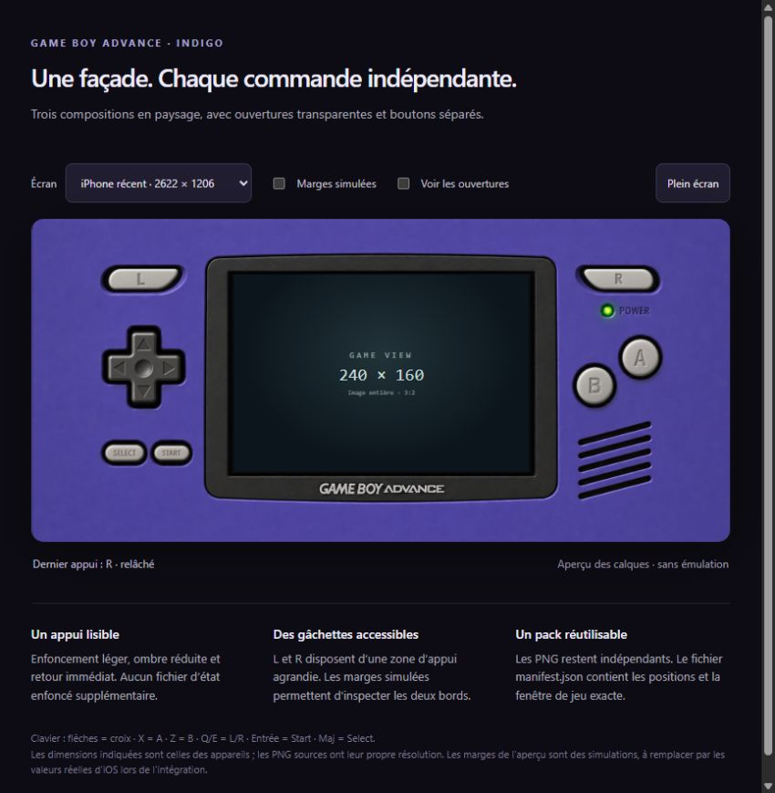

# Vérifications du premier pack

- 3 façades PNG RGBA, chacune avec 8 grandes ouvertures : écran et 7 logements.
- 7 boutons PNG RGBA indépendants, avec transparence extérieure.
- Rectangles des sprites et des logements contenus dans leurs images sources.
- Trois fenêtres de jeu aux proportions exactes 3:2, inscrites dans les ouvertures.
- Manifest de la démonstration identique au manifest d’intégration.
- Syntaxe JavaScript vérifiée et aperçu ouvert dans un navigateur Chromium sur ordinateur.
- Assemblages iPhone large, iPhone classique et iPad inspectés visuellement.
- Appui et relâchement d’une commande, affichage des ouvertures, simulation des marges et mode plein écran contrôlés.

La validation visuelle a été faite sur ordinateur. Les safe areas réelles, l’ergonomie au pouce, le multitouch et le rendu Retina doivent encore être contrôlés dans l’application sur les appareils iOS ciblés. Aucun moteur d’émulation n’est relié à l’aperçu.
